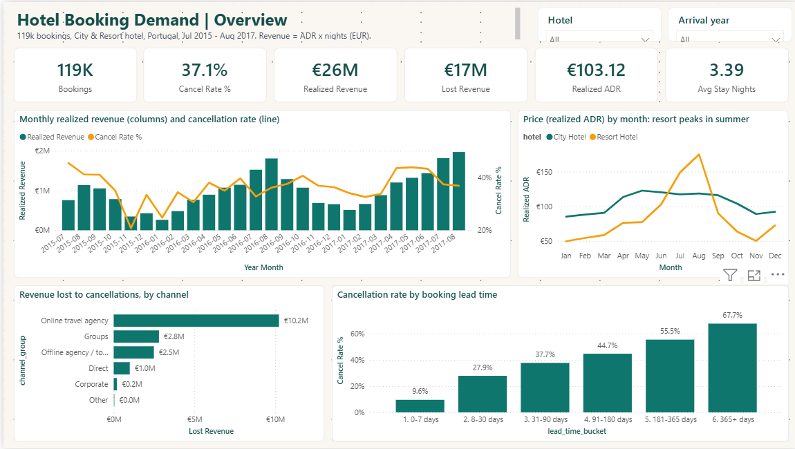
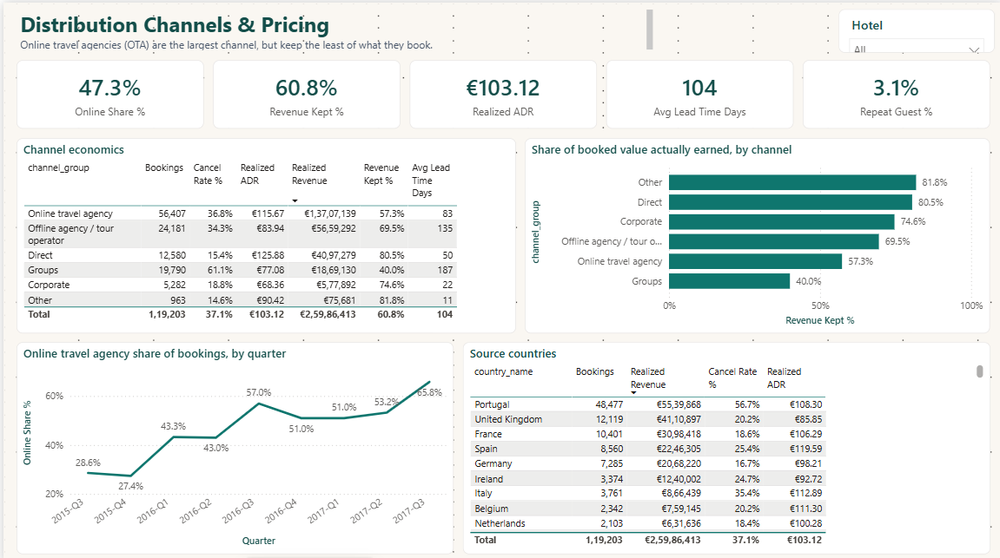
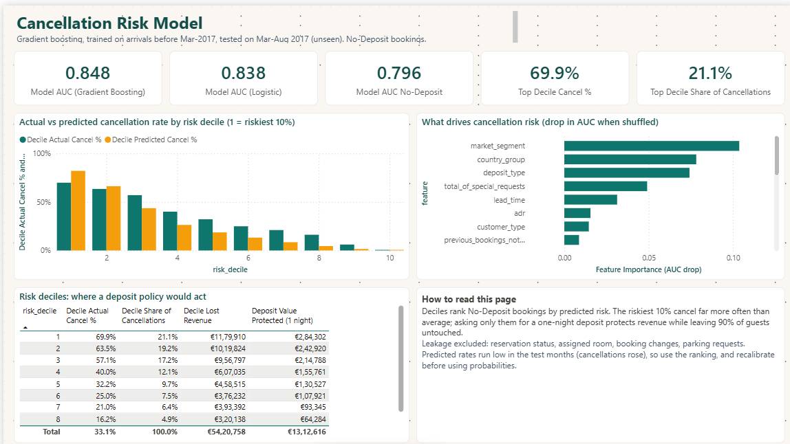
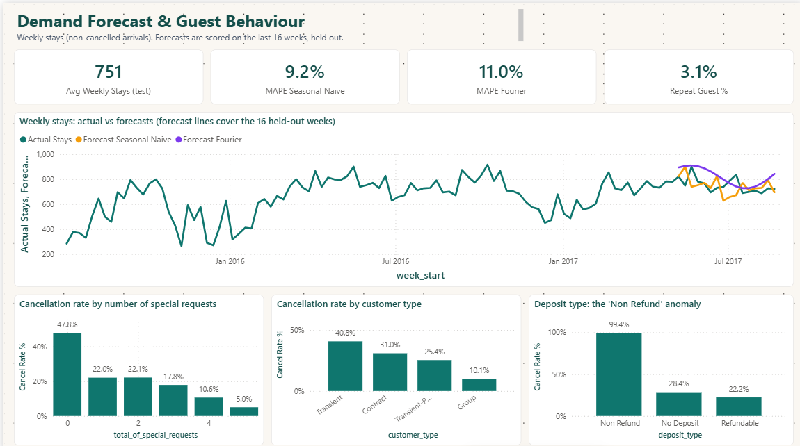

# Hotel Booking Demand: Channel, Cancellation & Revenue Analytics

**119k real hotel bookings analysed end to end: SQL, Python, a machine-learning cancellation model, a demand
forecast, an Excel what-if model and a Power BI dashboard, ending in revenue recommendations.**

`SQL (MySQL 8 / SQLite)` · `Python (pandas, scikit-learn, SciPy)` · `Machine learning` · `Forecasting` · `Excel (what-if, BINOM.DIST)` · `Power BI (DAX)`

---

## Business problem
A City hotel and a Resort hotel in Portugal sell rooms through online travel agencies (Booking.com, Expedia),
offline agencies, groups, corporate deals and their own direct channel. **39% of booked value is cancelled.**
Management wants to know:
1. Which **sales channels** bring revenue that actually materialises?
2. What drives **cancellations**, and can we predict them at the moment of booking?
3. What **policies** (deposits, overbooking, channel mix) would recover revenue?
4. How much **demand** should we expect in the coming weeks?

## Key findings
*Every number is generated by `python/run_all.py`. Details in [`outputs/INSIGHTS_REPORT.md`](outputs/INSIGHTS_REPORT.md).*

| # | Finding |
|---|---|
| 1 | **Online travel agencies: biggest and leakiest.** 47% of bookings and 53% of revenue, but 37% cancel, so the hotels keep only **57%** of OTA-booked value vs **81%** for direct bookings. The online share grew from 29% to 66% of bookings. |
| 2 | **Cancellations cost €16.7M**, 39% of all booked value. Risk rises with lead time (10% for bookings made within a week vs 56% for those made 6-12 months ahead). |
| 3 | **A model flags risky bookings at booking time.** Gradient boosting, tested on 6 unseen months: **ROC-AUC 0.85**. The riskiest 10% of No-Deposit bookings cancel **70%** of the time (average 33%). |
| 4 | **Targeted deposits pay.** A one-night deposit on only that riskiest 10% would have secured about **€261k net** in 6 months, after assuming 5% of those guests walk away. |
| 5 | **Overbook 2 rooms per 100.** Only 3.1% of bookings still on the books 3 days out fail to arrive. The binomial model finds the revenue-maximising level. |
| 6 | **Simple forecasting wins.** "Same week last year" forecast weekly stays with 9.2% error and beat a trend + seasonality regression. With 2 years of data, extra complexity did not help. |

## Dashboard (Power BI, 4 pages)
| Overview | Channels & Pricing |
|---|---|
|  |  |
| **Cancellation Risk Model** | **Demand Forecast & Guests** |
|  |  |

## Pipeline
```
data/raw/hotels.csv
  │ s01_clean_transform     audit · remove invalid rows · flag duplicates · derive revenue, channels, dates
  ▼
data/processed/fact_bookings.csv
  ├─► s02_build_database    SQL: 16 queries (sql/03-06), revenue, channels, cancellations, guests
  ├─► s03_eda               10 charts, channel economics, duplicate sensitivity check
  ├─► s04_cancellation_model  logistic regression vs gradient boosting, time-based split, deciles, policy
  ├─► s05_demand_forecast   seasonal naive vs growth-adjusted vs Fourier regression, 16-week holdout
  ├─► s06_excel_whatif      excel/Hotel_Revenue_WhatIf.xlsx (overbooking, deposit policy, channel mix)
  └─► outputs/INSIGHTS_REPORT.md + powerbi/Hotel_Booking_Dashboard.pbip
```

## How to run
```bash
pip install -r requirements.txt
python python/run_all.py          # about 30 seconds
python powerbi/build_pbip.py      # then open powerbi/Hotel_Booking_Dashboard.pbip and click Refresh
```
Download `hotels.csv` into `data/raw/` first (see the data link at the bottom).
Open `excel/Hotel_Revenue_WhatIf.xlsx` in Excel. The yellow cells are inputs.

## Judgment calls (what a reviewer should know)
- **Duplicates kept.** 32k identical rows, but the file has no booking ID, and group bookings legitimately repeat.
  They are flagged, and a sensitivity check shows the channel conclusions hold without them.
- **"Non Refund" anomaly.** 99% of "Non Refund" bookings were cancelled, so the policy analysis uses No-Deposit bookings only.
- **Leakage removed.** Reservation status, assigned room, booking changes and parking requests are not used by the model.
- **Time-based validation.** The model is trained on the past and tested on later months, like it would be used in practice.
- **Assumptions are labelled** in the Excel model (OTA commission, walk-away rate, relocation cost) and can be changed.

## Limitations
Two hotels in one country, 2015-2017. Room revenue only. Model probabilities need recalibration for recent data
(they rank well but run low). Channel-shift gains are an upper bound, because direct bookers are self-selected.

---
*Data: Antonio, de Almeida & Nunes (2019), "Hotel booking demand datasets", Data in Brief 22, 41-49;
`hotels.csv` via [TidyTuesday 2020-02-11](https://github.com/rfordatascience/tidytuesday/tree/master/data/2020/2020-02-11).*
